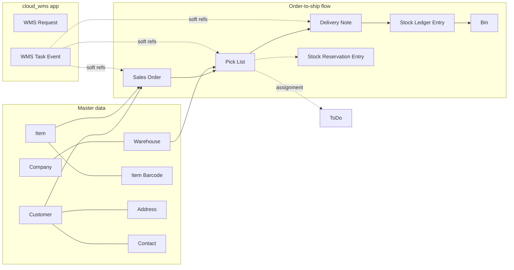
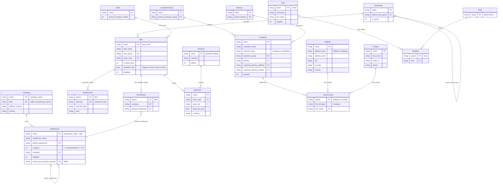
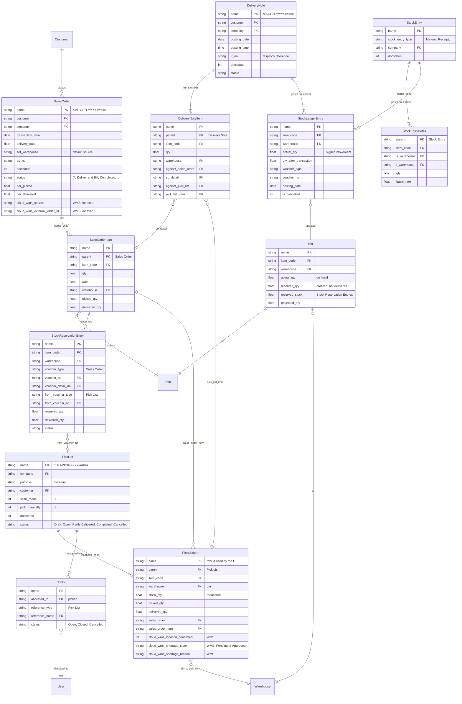
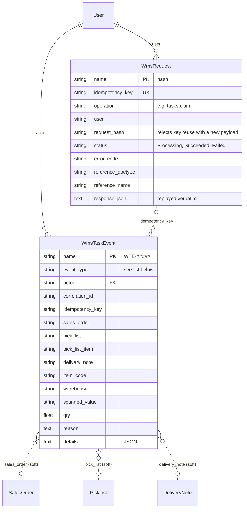

# Data model

Cloud WMS has almost no data model of its own. ERPNext's documents remain the
source of record. The `cloud_wms` app adds:

- a few **custom fields** on standard ERPNext doctypes;
- two **custom doctypes**, both technical: `WMS Request` (idempotency) and
  `WMS Task Event` (audit).

A WMS *pick task* is not a table. It is a view of an ERPNext `Pick List`, with
its `ToDo` assignment and the `cloud_wms_*` fields on its rows. A *location* is a
leaf `Warehouse` that has a barcode.

This document has two parts:

- **Current model:** the tables the implemented flow reads and writes.
- **Admin screens:** the CRUD screens for the `WMS Admin` role. Screens 1–4
  (Sales Orders, Customers, Products, Locations) are implemented; the rest are
  proposed.

Field lists show only the fields that the WMS uses or that an admin screen
needs. ERPNext doctypes have many more. Fields this app adds are marked
**WMS**.

## Conventions

- Every ERPNext table is `tab<DocType>` (for example `tabSales Order`) and has
  a string primary key, `name`. Child tables (`… Item`, `Item Barcode`) link to
  their parent through `parent`, `parenttype` and `parentfield`, and keep their
  order in `idx`.
- `docstatus` is `0` (draft), `1` (submitted) or `2` (cancelled). Submitted
  documents cannot be edited. They can only be cancelled and then amended into
  a new document.
- Tree doctypes (`Warehouse`, `Item Group`, `Customer Group`, `Territory`) use
  a parent link plus nested-set columns `lft` and `rgt`. Only leaf nodes
  (`is_group = 0`) can hold stock or be selected on transactions.
- Stock quantities are never written directly. `Bin` and `Stock Ledger Entry`
  change only when a stock transaction is submitted.

## Overview



## Master data



### Locations

Locations follow plan decision 4A: **a bin is a leaf `Warehouse`**. The tree is
`site → zone → aisle → bin`. Only bins have a `cloud_wms_location_barcode`, and
that is the value a picker scans. The demo tree is:

```text
MAIN - <abbr>                (group)
└── MAIN-A                   (group, zone)
    └── MAIN-A-01            (group, aisle)
        ├── MAIN-A-01-01     barcode LOC-MAIN-A-01-01
        ├── MAIN-A-01-02     barcode LOC-MAIN-A-01-02
        └── MAIN-A-01-03     barcode LOC-MAIN-A-01-03
```

Item scans resolve through `Item Barcode.barcode → parent`. Location scans
resolve through `Warehouse.cloud_wms_location_barcode`.

## Order-to-ship transactions



### Task status (derived, not stored)

`services/tasks.py` derives the WMS task status from the Pick List:

```mermaid
stateDiagram-v2
  [*] --> available: submitted Sales Order with remaining qty and no active Pick List
  available --> claimed: claim creates a draft Pick List + ToDo
  claimed --> available: release deletes the draft
  claimed --> picking: first location/item scan
  picking --> qa_required: row shortage state is Pending
  qa_required --> picking: supervisor approves; the row is reduced
  picking --> ready_to_dispatch: complete submits the Pick List (docstatus 1)
  ready_to_dispatch --> dispatched: dispatch submits the Delivery Note; status Completed
  dispatched --> [*]
```



Any quantity left on the Sales Order after a short pick makes it `available`
again.

## WMS app doctypes



The references on `WMS Task Event` are plain `Data` fields, not `Link`
fields. Audit rows therefore never block ERPNext from cancelling or deleting
documents, and they survive when the referenced document is deleted.

Event types: `Order Received`, `Task Released`, `Task Claimed`,
`Task Assigned`, `Task Released To Queue`, `Location Scanned`, `Item Scanned`,
`Pick Confirmed`, `Short Pick`, `Short Pick Approved`, `Task Completed`,
`Task Cancelled`, `Delivery Created`, `Delivery Submitted`,
`Delivery Cancelled`, `Inventory Corrected`, `Order Cancelled`, `Order Amended`,
`Master Data Changed`.

## Roles and permissions

| Role | Sales Order | Pick List | Stock Reservation Entry | Delivery Note | Stock Entry, Stock Reconciliation |
| --- | --- | --- | --- | --- | --- |
| WMS Intake | submit | – | – | – | – |
| WMS Picker | read | submit, delete | submit | – | – |
| WMS Dispatch | read | read | – | submit | – |
| WMS Supervisor | read | cancel, delete | cancel | cancel | – |
| WMS Admin | cancel, amend | cancel | cancel | cancel | cancel |

`WMS Admin` also has create, write and delete on `Customer`, `Address`,
`Contact`, `Item`, `Item Price` and `Warehouse`, and create and write on
`Customer Group`, `Territory` and `Item Group`. The `cloud_wms.api.admin`
endpoints accept only `WMS Admin`, except the Pick List and Delivery Note
endpoints (screen 7), which also accept `WMS Supervisor`. System Manager passes
every role check.

The source is `apps/cloud_wms/cloud_wms/setup/permissions.py`. Endpoints check
roles first. Where ERPNext needs reads outside this matrix (customer and tax
masters while a Delivery Note is mapped, for example), the service runs that
step as the system user.

---

## Admin screens

The **Admin** section of the WMS UI (`A1`–`A10` in the sidebar) maintains the
data that warehouse admins would otherwise edit in ERPNext Desk. It is visible
to `WMS Admin` and System Manager; `WMS Supervisor` sees only screen 7.

| # | Screen | Status | ERPNext doctypes | Operations | Notes and constraints |
| --- | --- | --- | --- | --- | --- |
| 1 | **Customers** | Implemented (A2) | `Customer`, `Address`, `Contact` (via `Dynamic Link`) | Create, read, update, disable, delete | Deletion fails once a customer is used on any transaction, so disable is the normal "delete". Customer Group and Territory are pick-lists. |
| 2 | **Products** | Implemented (A3) | `Item`, `Item Barcode`, `Item Price` (Standard Selling), `Item Default` | Create, read, update, disable, delete | Barcodes are edited inline, because they are what pickers scan. `stock_uom` and `is_stock_item` cannot change once stock exists. |
| 3 | **Locations** | Implemented (A4) | `Warehouse` (tree) | Create, read, update, disable, delete; move within the tree | Tree editor with a barcode field on bins. **Print labels** opens a browser print sheet of CODE128 labels for the selected bin, every bin under the selected group, or every bin. A group with children, or a bin with stock or ledger entries, cannot be deleted. |
| 4 | **Sales Orders** | Implemented (A1) | `Sales Order`, `Sales Order Item` | Create (existing intake), read, cancel, amend | Submitted orders are immutable, so "Edit" means cancel and amend. Cancelling is blocked while a pick task is open or a Delivery Note is submitted, so those are handled first. Close and hold stay in Desk. |
| 5 | **Stock & adjustments** | Implemented (A5) | `Bin` (read), `Stock Reconciliation`, `Stock Entry` (Material Receipt, Material Transfer) | Read on-hand by item × bin; post receipts, transfers and count corrections; cancel a posting | This is the only way to change quantities, and it is never a direct edit of `Bin`. Each posting and cancellation records an `Inventory Corrected` event. Material Issue is not offered; a count correction covers write-offs. |
| 6 | **Users & roles** | Stays in Desk | `User`, `Has Role` | Create, read, enable/disable, assign WMS roles | Lets a Supervisor or Admin assign WMS roles without Desk. Needs System Manager-level rights, so the endpoint should allow only the four WMS roles. |
| 7 | **Pick Lists & Delivery Notes** | Implemented (A7) | `Pick List`, `Delivery Note` | Read; cancel (Admin and Supervisor) | Exception handling for wrong dispatches. Cancelling a Delivery Note reverses its stock ledger entries and the delivered quantities on the Sales Order and the Pick List (`Delivery Cancelled`). Then cancelling the Pick List cancels its reservations and returns the order to the pick queue (`Task Cancelled`). Each blocker is shown with its next step: an open pick task is released, not cancelled; a submitted Delivery Note, Sales Invoice or return goes first; an order on hold or closed is reopened in Desk. |
| 8 | **Audit log** | Implemented (A8) | `WMS Task Event` | Read-only, with filters (event type, user, Sales Order, Pick List, Delivery Note, correlation id, date range) | Events are immutable, so the screen has no edit or delete. Newest 200 matches; each event expands to its JSON details. `WMS Request` (idempotency replay records) is not shown. |
| 9 | **Reference lists** | Implemented (A9) | `Customer Group`, `Territory`, `Item Group`, `UOM`, `Price List` | Read; create entries in the three trees | Rename, merge and delete stay in Desk. Each create records `Master Data Changed`. |
| 10 | **Settings** | Implemented (A10) | `Stock Settings`, `Selling Settings`, `Company` | Read-only | Shows why picking behaves as it does. Values the WMS enforces (`enable_stock_reservation`, `auto_reserve_stock`) are flagged when they drift; `bench migrate` restores them. |

Out of scope for now: suppliers and inbound flows (`Supplier`,
`Purchase Order`, `Purchase Receipt`), invoicing and accounting.

### Model changes

The admin screens add **no new business doctypes**. Implemented:

1. **Role `WMS Admin`.** See [Roles and permissions](#roles-and-permissions).
   Writes run as the signed-in user, so ERPNext's own permission and
   validation rules still apply.
2. **`cloud_wms.api.admin`.** One whitelisted endpoint set per entity
   (`list_*`, `get_*`, `save_*`, plus `delete_record`, `cancel_order` and
   `amend_order`, `post_stock`, `cancel_posting`, `cancel_pick_list`,
   `cancel_delivery_note`, `create_reference`), using `@wms_endpoint`. Every
   write is role-checked, idempotent and audited as `Master Data Changed`,
   `Order Cancelled`, `Order Amended`, `Inventory Corrected`, `Task Cancelled`
   or `Delivery Cancelled`. Saves carry the record's `modified` value and fail with
   `STALE` if someone else changed it. Duplicate barcodes fail with
   `DUPLICATE`, and deletes of linked records fail with `IN_USE` (disable
   instead). A generic "save any doctype" endpoint is deliberately excluded.

Still proposed, both optional:

- **`Warehouse.cloud_wms_location_type`** (Select: `Site`, `Zone`, `Aisle`,
  `Bin`). Today the level is implied by depth and `is_group`. An explicit type
  would let the tree editor enforce "a bin has a barcode; a group has none".
- **`Item.cloud_wms_pick_note`** (Small Text). Handling text shown on the pick
  screen, such as "fragile" or "two-person lift".

### Decisions

- Master data is administered by a separate **`WMS Admin`** role, not by
  Supervisors.
- Sales Orders are edited by **cancel and amend**: the original is cancelled
  and a copy (`<name>-1`, `amended_from` set) is submitted in one transaction.
  Cancelling is refused while a pick task is open or a Delivery Note is
  submitted.
- **Users & roles stay in ERPNext Desk**, because they need elevated rights.
- **Supervisors can cancel** Pick Lists and Delivery Notes (screen 7), because
  reversing a wrong dispatch is an operational exception, not master data.
- **Stock changes** are receipts, transfers and counts only. Material Issue is
  left out; a count correction records write-offs with a reason.
- **Settings are read-only** in the WMS UI; they change in Desk.
- **Location labels print from the browser** (HTML print with CODE128 barcodes
  rendered by JsBarcode), not through an ERPNext print format.
