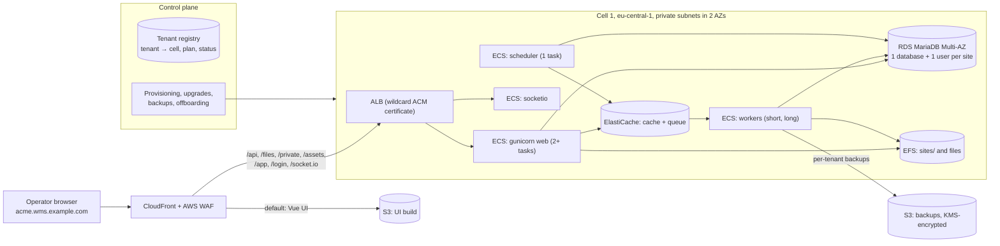

# Multi-tenancy and AWS hosting

Status: **proposal**. Nothing in this document is implemented yet. The local
Frappe Docker stack in this repository is for evaluation only and is not a
production deployment.

This document describes how Cloud WMS could be offered to many small and
medium-sized (SME) customers on AWS at low cost, while keeping each customer's
data isolated. It ends with a rough monthly cost for 20 tenants.

## Goals and constraints

- Many small tenants, each with low and bursty load. The cost per tenant must be
  low.
- Strong data isolation between tenants, suitable for GDPR and for later ISO 27001
  or SOC 2 audits.
- ERPNext stays an unmodified upstream distribution (see [AGENTS.md](AGENTS.md)).
  The tenancy model must therefore use what Frappe already supports.
- One image, built from [docker/Containerfile](docker/Containerfile) (upstream
  ERPNext plus `apps/cloud_wms`), for all tenants.
- Hosting in the EU (`eu-central-1`, Frankfurt) by default.

## Tenancy options

| Model | Isolation | Cost per tenant | Decision |
| --- | --- | --- | --- |
| Shared tables with a `tenant_id` column | Weak | Lowest | **Not possible.** ERPNext has no tenant column, and `Company` is not a security boundary. |
| Full stack per tenant (own containers, database, cache) | Strongest | About $250–400 a month (HA) | Too expensive for SMEs. Offer it as a premium or regulated tier only. |
| **Site and database per tenant, shared compute ("cells")** | Separate database, database user, encryption key and files; shared code and processes | About $30–40 a month at 20 tenants, falling with more tenants | **Default.** This is Frappe's native multi-site model and the one Frappe Cloud uses. |

### Decision

Each tenant is one **Frappe site**:

- its own MariaDB database, with a separate database user and password;
- its own `site_config.json` and `encryption_key`;
- its own public and private file folders;
- its own ERPNext users, roles, Company and Warehouse tree.

Many sites share one **cell**: one set of containers built from the same image,
one RDS database instance and one Redis pair. Frappe chooses the site for each
request from the HTTP `Host` header (`dns_multitenant`). The `cloud_wms` app needs
no tenant-specific code, because every query already runs inside one site's
database.

Large, noisy or regulated tenants move to a **dedicated cell**. A dedicated cell
uses the same infrastructure code, holding a single site.

## Target architecture

### Cell components

| Component | AWS service | Notes |
| --- | --- | --- |
| UI | S3 and CloudFront | One build serves all tenants. The tenant comes from the hostname, so the UI needs no per-tenant build. |
| Routing | CloudFront path behaviours to an ALB | `/api/*` and the other Frappe paths go to the ALB with the original `Host` header. The session cookie stays first-party, as it does today with the Vite `/api` proxy. |
| Web | ECS service: `gunicorn` | At least 2 tasks across 2 Availability Zones. |
| Realtime | ECS service: `node socketio` | Used by Desk. The WMS UI does not depend on it today. |
| Background jobs | ECS services: `worker` (short/default and long queues) | Scale on queue length. |
| Scheduler | ECS service: `schedule`, exactly 1 task | One scheduler loops over every site in the bench. |
| Database | RDS for MariaDB, Multi-AZ | Stay on RDS for MariaDB, because MariaDB is the database ERPNext officially supports (rather than Aurora MySQL). Each site has about 1,000 tables, so tune `table_open_cache` and `open_files_limit`, and limit each instance to roughly 100–200 SME sites. |
| Cache and queue | ElastiCache (Redis or Valkey), 2 nodes | Frappe prefixes keys by site. Redis is shared, not isolated; it holds no data that is not also in MariaDB. |
| Site files | EFS | The `sites/` directory (site configs and uploaded files) must be shared by all containers in a cell. |
| Backups | S3 with a lifecycle policy | One prefix per tenant. |
| Image | ECR | The image built from `docker/Containerfile`, tagged per release. |

### Domains

- Each tenant gets a subdomain, such as `acme.wms.example.com`. One wildcard ACM
  certificate covers both CloudFront and the ALB.
- Customer-owned domains (`wms.acme.de`) need their own certificate. Add them
  through `bench setup add-domain` and an extra ACM certificate (ALB and CloudFront
  both have certificate limits), or put them behind a premium tier.

## Security controls

The main risk of shared compute: every web and worker process in a cell can read
every site's `site_config.json`, which holds that site's database password. A
remote-code-execution bug in Frappe, ERPNext or `cloud_wms` therefore exposes the
whole cell, not one tenant. The controls below reduce the likelihood and the blast
radius.

| Area | Control |
| --- | --- |
| Tenant admin rights | Tenants never get `Administrator`, or `System Manager` with scripting rights. Routine admin work uses the WMS Admin screens; users and roles are created through the control plane or by an operator. |
| Code execution | Keep server scripts disabled (`server_script_enabled` unset). No developer mode. No tenant-specific custom apps in shared cells. Block the System Console and the report builder's raw SQL for tenant users. |
| Database | One database user per site, with grants on its own database only. TLS to RDS. RDS is in private subnets and accepts traffic only from the cell's security group. |
| Encryption | KMS keys for RDS, EFS, S3 and backups, with one key per cell. Each site keeps its own `encryption_key` for encrypted fields. |
| Secrets | Database passwords, site encryption keys and SMTP credentials live in Secrets Manager. They are written into the site configs at deploy time. |
| Edge | AWS WAF with managed rule sets and rate limits on login. Frappe's per-site `rate_limit` adds a second layer. HTTPS only, with HSTS. |
| Operator access | No SSH. Break-glass access goes through SSM Session Manager and is logged in CloudTrail. Desk access for operators uses MFA. |
| Identity | Per-tenant SSO through Frappe's OAuth/OIDC social login (Microsoft Entra ID, Google). |
| Audit | Business audit: `WMS Task Event` and ERPNext document versions. Platform audit: CloudTrail, VPC Flow Logs and GuardDuty. |
| Patching | Rebuild the image for every Frappe/ERPNext security release and roll it out across cells within days. |
| Data protection | EU region, a data processing agreement (DPA) with each customer, per-tenant backups and verified deletion when a customer leaves. |

## Control plane

The control plane is a small internal service, for example Lambda and Step
Functions with a DynamoDB tenant registry.

- **Provision**
  1. Choose a cell with spare capacity.
  2. Run `bench new-site <host> --install-app erpnext --install-app cloud_wms` as a one-off ECS task.
  3. Store the secrets, create the DNS record and set the site limits.
  4. Create the tenant's first `WMS Admin` user.
  5. Run the ERPNext setup wizard with the tenant's company data.
- **Upgrade**
  1. Build and push a new image.
  2. Deploy it to a canary cell.
  3. Run `bench --site <site> migrate` for each site; sites can run in parallel within a maintenance window.
  4. Roll the remaining cells.

  Never run new code against a site that has not been migrated: put the site into maintenance mode while it migrates.
- **Back up**
  - Nightly `bench --site <site> backup --with-files` to the tenant's S3 prefix, so one tenant can be restored without the others.
  - RDS automated backups with point-in-time recovery for whole-cell recovery.
- **Move a tenant** to another cell, for example a dedicated one: take a backup, restore it in the new cell, then switch DNS.
- **Suspend and offboard**
  - To suspend, put the site in maintenance mode and pause its scheduler (`bench --site <site> disable-scheduler`).
  - On offboarding:
    1. Export the tenant's data.
    2. Drop the site (`bench drop-site`).
    3. Delete its backups after the agreed retention period.
- **Meter**: record active users, orders and storage per site for billing.

## Scaling and noisy neighbours

- One scheduler runs every site's scheduled ERPNext jobs. Scheduled jobs grow
  with the number of sites, so watch the queue length and add workers.
- `bench migrate` time grows with the number of sites in a cell. This is another
  reason to keep cells to roughly 100–200 sites.
- Heavy reports or imports from one tenant can slow its neighbours. Put long jobs
  on the `long` queue, and move persistently heavy tenants to their own cell.

## Rough AWS cost for 20 tenants

These are **estimates** from AWS list prices for `eu-central-1`, checked in
November 2026, in USD, without VAT. Prices change. Confirm the final design in the
[AWS Pricing Calculator](https://calculator.aws/).

### Assumptions

- 20 SME tenants in one production cell. Each has about 5–15 operators working
  office hours, a few hundred orders a day and under 2 GB of database and files.
- High availability: two Availability Zones and a Multi-AZ database.
- Fargate on Graviton (Arm). At this size it costs about the same as EC2 and needs
  less operational work.
- One month = 730 hours.

### Production cell (on-demand)

| Item | Sizing | USD / month |
| --- | --- | ---: |
| RDS for MariaDB | `db.m7g.large` (2 vCPU, 8 GiB), Multi-AZ | 292 |
| RDS storage | 100 GB gp3, Multi-AZ | 28 |
| RDS backup storage | Point-in-time recovery beyond the free allowance | 5 |
| ECS Fargate (Arm) | Web 2 × (1 vCPU, 2 GB); workers 1 × (1 vCPU, 2 GB); scheduler and socketio 2 × (0.25 vCPU, 0.5 GB). In total 3.5 vCPU and 7 GB at $0.03725 per vCPU-hour and $0.00409 per GB-hour. | 120 |
| ElastiCache | 2 × `cache.t4g.small` (cache and queue) | 53 |
| Application Load Balancer | 1 ALB with light load, plus 2 public IPv4 addresses | 32 |
| NAT gateways | 2 (one per AZ), including public IPv4 and light traffic | 84 |
| EFS | About 20 GB of site files | 10 |
| S3 | UI build and 30 days of per-tenant backups (about 300 GB) | 10 |
| CloudFront | Within the 1 TB monthly free tier | 5 |
| AWS WAF | 1 web ACL, about 5 rules, about 10 million requests | 16 |
| Route 53 | 1 hosted zone and queries | 2 |
| Secrets Manager | About 25 secrets | 10 |
| KMS | 3 customer-managed keys | 3 |
| CloudWatch | About 20 GB of logs, metrics and alarms | 25 |
| GuardDuty, Security Hub, AWS Config | Small account | 30 |
| ECR, SES, other | | 5 |
| **Total** | | **≈ 730** |
| **Per tenant** | | **≈ 37** |

### With 1-year commitments

| Change | Saving per month |
| --- | ---: |
| RDS reserved instance, 1 year, no upfront (about $107 instead of $146 per instance) | about 78 |
| Compute Savings Plan on Fargate (about 20%) | about 24 |
| ElastiCache reserved nodes (about 30%) | about 15 |
| **Total with commitments** | **≈ 615 ($31 per tenant)** |

### Other environments and costs

| Item | USD / month | Notes |
| --- | ---: | --- |
| Staging cell | ≈ 200 | Single-AZ `db.t4g.medium`, 1 NAT gateway, about 1.5 vCPU of Fargate. Less if stopped outside office hours. |
| AWS Business Support | ≥ 100 | The greater of $100 or a percentage of usage. Recommended for a paid service. |
| Data transfer out | Usually 0–20 | Most traffic is small JSON responses through CloudFront. |
| **Realistic total for 20 tenants** | **≈ 900–1,050** | Production, staging and support: about **$45–55 per tenant**. |

Not included: VAT, people and on-call time (usually the largest cost), an
external observability tool, penetration tests, certification audits, domains and
the developer environments.

### How the cost scales

Most of the cost is fixed per cell, so the cost per tenant falls quickly as a cell
fills up. These figures are very rough and assume production only, on-demand:

| Tenants in the cell | Main changes | USD / month | Per tenant |
| ---: | --- | ---: | ---: |
| 20 | As above | ≈ 730 | ≈ 37 |
| 50 | `db.m7g.xlarge` Multi-AZ, 250 GB, about 5.5 vCPU of Fargate | ≈ 1,180 | ≈ 24 |
| 100 | `db.m7g.xlarge` Multi-AZ, 500 GB, about 8 vCPU of Fargate, 2 × `cache.t4g.medium` | ≈ 1,500 | ≈ 15 |

A cheaper option at 20 tenants (single-AZ database, 1 NAT gateway) costs about
$520 a month. It is fine for a pilot, but a database failure then means an outage
of 20–30 minutes for every tenant.

## Risks and open decisions

- **Shared-process blast radius.** This is accepted for the SME tier. Regulated
  customers get a dedicated cell.
- **ERPNext upgrades at scale.** A major-version migrate can take minutes per
  site. Plan maintenance windows and test the migrate on copies of the largest
  sites first.
- **Desk access for tenants.** Deciding which tenant users may use ERPNext Desk,
  and with which roles, is a product decision that affects the security controls
  above.
- **Licensing.** ERPNext is GPLv3 and Frappe is MIT. Running them as a hosted
  service is generally allowed under GPLv3. Check the obligations with counsel
  before distributing `cloud_wms` or the image to customers.
- **Build or buy.** Frappe Cloud already runs this model and could host the bench
  (including the `cloud_wms` app) at first, with the WMS UI on S3 and CloudFront.

## Next steps

1. Write infrastructure code (Terraform or AWS CDK) for one cell and the edge
   (CloudFront, WAF, Route 53).
2. Write a provisioning script that wraps `bench new-site`, installs `cloud_wms`
   and creates the first `WMS Admin` user.
3. Add a production build of the UI that is served from S3, replacing the Vite
   proxy.
4. Run a pilot with 2–3 tenants in a single cell, then measure the real cost and
   capacity before onboarding more tenants.
